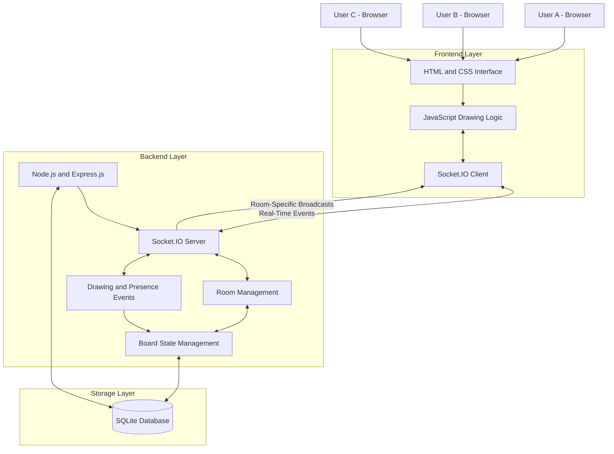
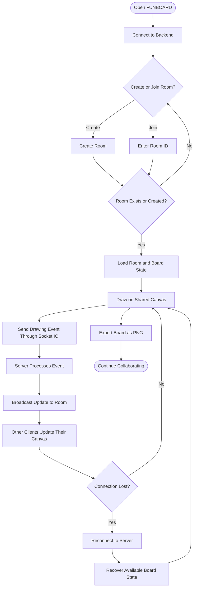
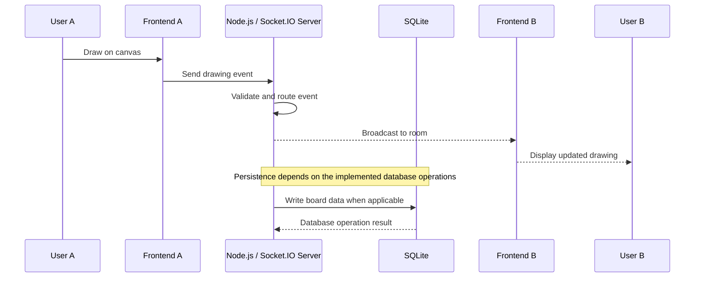
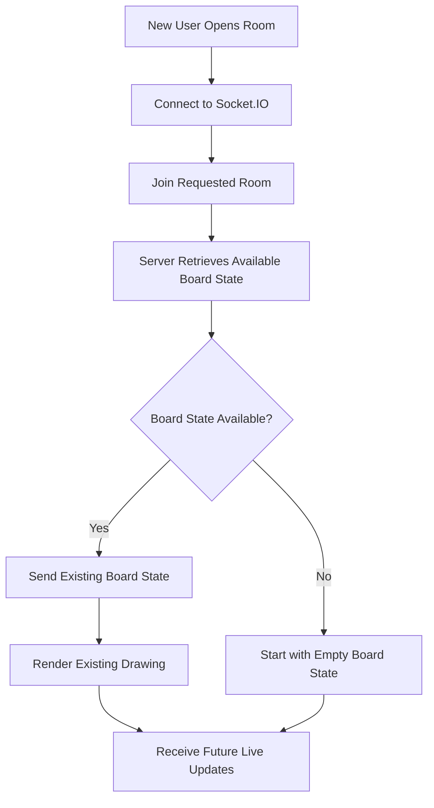

# FUNBOARD — Real-Time Collaborative Whiteboard

### Built by Team 4 LOOPS | Hack4Haldia '26

**FUNBOARD** is a real-time collaborative whiteboard that allows multiple users to draw, brainstorm, and collaborate on a shared digital canvas. Users can create a room, invite others using a unique Room ID or shareable link, and see drawing updates from other participants in real time.

Built using **HTML, CSS, JavaScript, Node.js, Express.js, Socket.IO, and SQLite**, FUNBOARD demonstrates real-time communication, room-based state management, database persistence, and full-stack web application deployment.

<p align="center">
  <strong>Team:</strong> 4 LOOPS
  <br>
  <strong>Event:</strong> Hack4Haldia '26
  <br>
  <strong>Status:</strong> Deployed on Render
</p>

---

## Table of Contents

- [Overview](#overview)
- [Problem Statement](#problem-statement)
- [Our Solution](#our-solution)
- [Key Features](#key-features)
- [Tech Stack](#tech-stack)
- [System Architecture](#system-architecture)
- [Application Flowchart](#application-flowchart)
- [Real-Time Collaboration Workflow](#real-time-collaboration-workflow)
- [Room and Board State Management](#room-and-board-state-management)
- [Database and Data Persistence](#database-and-data-persistence)
- [Project Structure](#project-structure)
- [API Documentation](#api-documentation)
- [Installation and Local Setup](#installation-and-local-setup)
- [Environment Variables](#environment-variables)
- [Running the Application](#running-the-application)
- [Testing](#testing)
- [Deployment on Render](#deployment-on-render)
- [Hackathon Requirement Checklist](#hackathon-requirement-checklist)
- [Limitations and Future Improvements](#limitations-and-future-improvements)
- [Team 4 LOOPS](#team-4-loops)
- [Acknowledgements](#acknowledgements)

---

## Overview

Remote collaboration tools are useful for brainstorming, planning, teaching, and teamwork. However, building a responsive shared canvas requires more than drawing on a webpage: multiple users must see the same updates, participants who join late must receive the existing board, and temporary disconnections should not unnecessarily destroy the shared work.

FUNBOARD addresses these challenges with a room-based collaborative drawing system.

Each room acts as an isolated collaboration space. Participants connected to the same room can exchange drawing events and view the shared canvas, while different rooms remain logically separated.

The application combines a browser-based frontend, a Node.js backend, Socket.IO for real-time communication, and SQLite for persistent data storage.

### Project Details

| Attribute | Details |
|---|---|
| Project Name | FUNBOARD |
| Category | Full-Stack Web Development / Real-Time Collaboration |
| Hackathon | Hack4Haldia '26 |
| Team Name | 4 LOOPS |
| Frontend | HTML, CSS, JavaScript |
| Backend | Node.js, Express.js |
| Real-Time Layer | Socket.IO |
| Database | SQLite |
| Deployment | Render |
| Multi-instance Messaging | Redis pub/sub not implemented |

---

## Problem Statement

Collaborative whiteboards make it easier for teams to exchange ideas visually. Implementing one reliably introduces several technical challenges:

- Synchronizing drawing actions across multiple connected users.
- Keeping users in separate rooms isolated from one another.
- Providing the current board state to participants who join after drawing has started.
- Handling disconnects and reconnects without unnecessarily losing the shared work.
- Supporting additional collaboration features such as undo/redo, live cursors, and image export.
- Persisting application data beyond a single browser session or server process.

FUNBOARD was developed to address these challenges within a hackathon environment.

## Our Solution

FUNBOARD provides a browser-based shared canvas backed by a real-time server.

The application follows this general workflow:

1. A user creates a room or joins an existing room using its ID.
2. The frontend establishes a connection with the backend using Socket.IO.
3. Drawing actions are sent to the server as real-time events.
4. The server routes relevant updates to participants in the same room.
5. The current board state can be supplied to late joiners through the board synchronization mechanism.
6. SQLite provides persistent storage through the backend's database layer.
7. Additional features provide drawing history controls, participant visibility, and PNG export.

The result is a collaborative application that can be accessed through a deployed web URL without requiring users to install a desktop application.

---

## Key Features

### 1. Room Creation and Joining

- Create a collaboration room.
- Join a room using its unique ID.
- Share room access through a link.
- Keep collaboration scoped to the selected room.

### 2. Real-Time Drawing Synchronization

- Capture drawing actions in the browser.
- Communicate updates using Socket.IO.
- Broadcast drawing updates to the appropriate room.
- Allow multiple connected participants to work on the same board.

### 3. Board-State Recovery

- Maintain board state through the server-side state-management logic.
- Send existing board content to users joining after drawing has begun.
- Support board recovery through the implemented reconnection and synchronization mechanisms.

### 4. Undo and Redo

The reported implementation includes per-user undo/redo functionality, allowing participants to reverse and restore their drawing actions.

### 5. Live Cursors and Presence

The reported implementation includes cursor updates and participant-presence handling to make collaborative activity easier to follow.

### 6. PNG Export

Users can export the whiteboard as a PNG image for saving or sharing their work.

### 7. Persistent Database Layer

SQLite provides file-based storage through the backend database module. Actual durability depends on the database configuration and the filesystem used by the deployment environment.

### 8. Responsive User Interface

The frontend includes a responsive layout intended to keep room controls, drawing tools, and collaboration information usable across different screen sizes.

---

## Tech Stack

| Technology | Role in FUNBOARD |
|---|---|
| HTML5 | Defines the application's interface and page structure. |
| CSS3 | Provides styling, layout, and responsive design. |
| JavaScript | Implements frontend interactions and drawing behavior. |
| Node.js | Runs the JavaScript backend. |
| Express.js | Handles HTTP routes, room-related APIs, health checks, and static content delivery. |
| Socket.IO | Provides real-time, bidirectional event communication between clients and the server. |
| SQLite | Provides file-based database storage. |
| npm | Manages Node.js dependencies and project scripts. |
| Render | Hosts the deployed web application and backend service. |
| Git and GitHub | Support version control and source-code collaboration. |
| Node.js Test Runner | Runs the project's automated backend and real-time functionality tests. |

### Why Socket.IO?

Ordinary HTTP requests are well suited to operations such as creating a room or retrieving room details. Continuous collaborative drawing requires a more immediate communication mechanism.

Socket.IO provides event-based, bidirectional communication between the browser and server. It also provides room-based broadcasting, which is useful for sending events to participants collaborating on the same board.

**Important distinction:** Socket.IO is the real-time communication layer. It is not the database, and its room mechanism does not automatically make application data durable.

### Why SQLite?

SQLite stores data in a database file and does not require a separate database server process. This makes it practical for a compact hackathon application.

The backend database module handles database-related operations. For production deployments, the database file must be placed on storage that survives service restarts if durable persistence is required.

### Why Express.js?

Express.js provides the HTTP application layer. It is used for application routes, room-related endpoints, health checks, and serving the frontend.

### Why Render?

Render provides a public hosting environment, allowing users and judges to access FUNBOARD through a web URL rather than running the application locally.

---

## System Architecture

FUNBOARD uses a client-server architecture.

The frontend manages user interaction and drawing. The backend manages room-related operations and real-time events. Socket.IO delivers updates to the relevant participants, while SQLite provides the database layer.

### Architecture Diagram



The diagram describes the logical architecture. Exact persistence behavior depends on which board-state operations are written to SQLite and which are maintained in server memory.

### Architecture Components

**Frontend layer**

- Renders the interface and drawing canvas.
- Captures user interactions.
- Sends drawing and room-related events.
- Displays updates received from the server.

**Backend layer**

- Processes HTTP requests.
- Manages room-related operations.
- Handles Socket.IO connections and room-specific events.
- Coordinates board synchronization and participant activity.

**Storage layer**

- Uses SQLite through the backend database module.
- Provides file-based persistence for the data written by the application.
- Depends on the configured database path and deployment storage for durability.

---

## Application Flowchart

The following flowchart illustrates the general user journey.



The reconnect path assumes the application can recover the relevant board state from its available server-side state or persisted data. A temporary network disconnect alone does not guarantee recovery if the server state or database contents have been lost.

---

## Real-Time Collaboration Workflow

The real-time workflow is central to FUNBOARD.

### Example: Two Users Drawing Together

Suppose User A and User B are connected to the same room.

1. User A begins drawing.
2. The frontend captures the drawing interaction.
3. The Socket.IO client sends the corresponding event to the backend.
4. The server processes the event and broadcasts it to the appropriate room.
5. User B receives the event.
6. User B's frontend updates the canvas.
7. The same process repeats as additional drawing events occur.

### Sequence Diagram



The database write shown above is conditional: not every transient event necessarily results in a database write. The actual persistence policy is determined by the backend implementation.

### Room Isolation

Room-based communication ensures that drawing events are routed to the relevant collaboration room rather than indiscriminately sent to every connected user.

This is important for supporting multiple independent whiteboards on the same server.

---

## Room and Board State Management

Room management and board-state management are related but separate responsibilities.

### Room Management

The server handles room-related operations, such as creating a room and retrieving its details. Socket.IO rooms can group connected clients for targeted broadcasts.

### Board-State Management

The application needs a representation of the drawing data associated with each room. That state can be used to synchronize existing content with a newly connected participant.

### Late Joiner Workflow



For reliable recovery, the server's in-memory state and the database must be handled consistently. If state is only in memory, a server restart can remove it. If state is persisted to SQLite, recovery is possible only for the data actually written to the database and retained by the hosting environment.

---

## Database and Data Persistence

### Database Used: SQLite

FUNBOARD uses SQLite rather than a separate hosted database server.

SQLite stores information in a database file. The backend's database module is responsible for database-related operations.

### Where Is the Database Stored?

The database location is controlled by the application's configuration, including the `DB_PATH` environment variable when configured.

Examples:

| Environment | Possible location | Persistence considerations |
|---|---|---|
| Local development | A local `.db` file at the configured path | Usually remains on the developer's machine until removed. |
| Render without a persistent disk | A file on the service filesystem | Data may be lost when the filesystem is replaced or the service is restarted or redeployed. |
| Render with a persistent disk | For example, `/var/data/whiteboard.db` | Can survive supported service restarts and redeployments when correctly mounted and configured. |

The path `/var/data/whiteboard.db` is an example configuration, not a claim about the currently active production database path.

### Configure a Persistent Database Path

If a persistent Render disk is attached and mounted at `/var/data`, configure:

```env
DB_PATH=/var/data/whiteboard.db
```

Do not configure this path unless the directory is available in the deployed service.

### Important Storage Considerations

- A SQLite database is a file, not a remote database URL.
- The database file must be accessible to the running backend.
- A database file on ephemeral hosting storage is not guaranteed to survive restarts or redeployments.
- Server memory and database storage are different: not all live state is automatically persisted.
- Redis pub/sub is not part of the reported implementation.

For production-grade multi-instance deployments, a persistent shared database and a suitable real-time messaging strategy should be evaluated.

---

## Project Structure

The following is the intended high-level structure of the project. File names may vary slightly from the final repository.

```text
TEAM-B-HACK-4-HALDIA-VOYAGE/
│
├── backend/
│   ├── server.js              # Express application and Socket.IO server
│   ├── db.js                  # SQLite database operations
│   └── tests/
│       └── test_server.js     # Backend and real-time tests
│
├── frontend/
│   ├── index.html             # Frontend entry page
│   ├── css/
│   │   └── style.css          # Application styles
│   └── js/
│       └── client.js          # Frontend interactions and real-time client
│
├── index.html                 # Root-level entry page, if configured
├── package.json               # Dependencies and npm scripts
├── package-lock.json          # Dependency lockfile
├── render.yaml                # Render deployment configuration
├── .env.example               # Example environment variables
├── .gitignore                 # Files excluded from Git
└── README.md                  # Project documentation
```

### Important Files

| File | Responsibility |
|---|---|
| `backend/server.js` | Defines the backend server, HTTP routes, and Socket.IO behavior. |
| `backend/db.js` | Handles SQLite initialization and database operations. |
| `frontend/index.html` | Defines the main frontend page. |
| `frontend/css/style.css` | Contains the interface styling and responsive rules. |
| `frontend/js/client.js` | Contains browser-side collaboration logic. |
| `backend/tests/test_server.js` | Contains automated tests for backend behavior. |
| `package.json` | Defines the npm scripts and dependencies. |
| `render.yaml` | Describes deployment settings for Render. |
| `.env.example` | Documents supported environment configuration. |

---

## API Documentation

The backend includes the following HTTP endpoints.

### 1. Health Check

```http
GET /health
```

Checks the health of the running service. The reported implementation includes server uptime, Node.js information, and database connectivity information.

Example request:

```bash
curl http://localhost:3000/health
```

Example response shape:

```json
{
  "status": "ok"
}
```

The actual response may include additional fields, depending on the current implementation.

### 2. Create a Room

```http
POST /api/rooms
```

Creates a room through the backend's room-management API.

Example request:

```bash
curl -X POST http://localhost:3000/api/rooms
```

The exact request body and response fields should be taken from the current implementation.

### 3. Retrieve Room Details

```http
GET /api/rooms/:id
```

Retrieves information for a room using its ID.

Example:

```bash
curl http://localhost:3000/api/rooms/ROOM_ID
```

Replace `ROOM_ID` with a room ID generated by the application.

### Socket.IO Events

Socket.IO provides the real-time communication layer. The reported implementation includes drawing synchronization, room-specific communication, cursor and presence handling, and board-state recovery.

Event names and payload schemas are implementation-specific; consult `backend/server.js` and `frontend/js/client.js` for the exact event contract.

---

## Installation and Local Setup

### Prerequisites

Install the following:

- Node.js with npm.
- Git.
- A code editor such as Visual Studio Code.

Check your installation:

```bash
node --version
npm --version
git --version
```

### Step 1: Clone the Repository

```bash
git clone https://github.com/arpbiswas04-coder/TEAM-B-HACK-4-HALDIA-VOYAGE.git
```

Enter the project directory:

```bash
cd TEAM-B-HACK-4-HALDIA-VOYAGE
```

### Step 2: Select the Project Branch

If the implementation is on `team-b-solution`, use:

```bash
git checkout team-b-solution
```

### Step 3: Install Dependencies

From the directory containing the root `package.json`, run:

```bash
npm install
```

This installs the Node.js dependencies declared by the project.

### Step 4: Configure Environment Variables

If the project requires a local `.env` file, copy the example:

**Windows PowerShell**

```powershell
Copy-Item .env.example .env
```

Review `.env.example` and update the values as required. Do not commit secret values to GitHub.

### Step 5: Start the Server

```bash
npm start
```

If the application starts successfully, open the local URL printed in the terminal. The default port in the reported configuration is `3000`, so the usual local URL is:

```text
http://localhost:3000
```

If a different port is configured, use the URL corresponding to that port.

### Step 6: Verify the Backend

Open the health endpoint:

```text
http://localhost:3000/health
```

A healthy response indicates that the server is running. Check the returned database status as well, if provided.

---

## Environment Variables

The project provides an `.env.example` file for documenting its configuration.

| Variable | Purpose |
|---|---|
| `PORT` | Port on which the server listens. |
| `HOST` | Network interface used by the server. The reported configuration defaults to `0.0.0.0`. |
| `NODE_ENV` | Controls the application environment, such as development or production. |
| `DB_PATH` | Configures the location of the SQLite database file when supported by the current implementation. |

Example local configuration:

```env
PORT=3000
HOST=0.0.0.0
NODE_ENV=development
DB_PATH=./data/whiteboard.db
```

Use the exact paths supported by your current database configuration. If a relative SQLite path is used, its resolved location depends on the backend's working directory and path-handling logic.

For Render, configure environment variables in the service dashboard. Render normally supplies the `PORT` variable, so the application should use the supplied value rather than relying on a fixed production port.

---

## Running the Application

### Start the Backend

```bash
npm start
```

### Run the Tests

```bash
npm test
```

These commands depend on the scripts defined in `package.json`.

### Test the Application Manually

1. Open FUNBOARD in one browser window.
2. Create a room.
3. Open a second window or browser session.
4. Join the same room using its ID or shareable link.
5. Draw in the first window and observe the second.
6. Join another participant after some drawing has already occurred.
7. Check whether the existing board is recovered.
8. Test undo/redo, cursors, participant presence, and PNG export.
9. Disconnect and reconnect a participant.
10. Restart the local server and verify whether the expected persisted board data is recovered.

The last step is especially important for distinguishing in-memory state from database persistence.

---

## Testing

The previous implementation report stated that **14 automated checks passed**.

The reported test coverage included:

- Health endpoint behavior.
- Room creation and room lookup.
- Socket.IO drawing synchronization.
- Late-joiner board recovery.
- Isolation between rooms.
- Per-user undo/redo.
- Clear-board behavior.
- Disconnect and participant-presence handling.
- Invalid payload handling.
- Static asset serving.
- SQLite persistence across a server restart.

The report also stated that the frontend production build succeeded and that the health endpoint returned a healthy status with database connectivity.

These are results from the previous implementation report. Run `npm test` against the current branch to reproduce and confirm them.

### Recommended Manual Verification

| Test | Expected behavior |
|---|---|
| Create a room | A room is created and can be joined. |
| Join by ID | A participant enters the intended room. |
| Live drawing | Other participants in the room receive drawing updates. |
| Room isolation | Updates do not leak into unrelated rooms. |
| Late joiner | Existing board content is recovered when available. |
| Reconnection | A returning participant can recover the available board state. |
| Undo/redo | The implemented undo/redo behavior works as expected. |
| Cursor and presence | Participant activity is reflected in the interface. |
| PNG export | The board can be exported as an image. |
| Persistence | Expected data survives a restart when correctly persisted. |

---

## Deployment on Render

FUNBOARD is deployed using Render.

### Deployment Configuration

The reported deployment configuration uses:

| Setting | Value |
|---|---|
| Service Type | Web Service |
| Runtime | Node.js |
| Branch | `team-b-solution` |
| Build Command | `npm install` |
| Start Command | `npm start` |
| Health Check Path | `/health` |
| Environment | `NODE_ENV=production` |
| Host | `0.0.0.0` |

Keep the root directory blank if the root `package.json` contains the application's scripts and dependencies.

### Deployment Steps

1. Push the latest project changes to GitHub.
2. Create or open the Web Service in Render.
3. Connect the repository.
4. Select the `team-b-solution` branch.
5. Configure the build and start commands.
6. Configure the required environment variables.
7. Set `/health` as the health-check path.
8. Deploy the application.
9. Open the public URL supplied by Render.
10. Test room creation and real-time synchronization using two separate browser sessions.

### Live Demo

**Live Application:** `ADD_YOUR_RENDER_URL_HERE`

**GitHub Repository:**  
https://github.com/arpbiswas04-coder/TEAM-B-HACK-4-HALDIA-VOYAGE

**Development Branch:**  
https://github.com/arpbiswas04-coder/TEAM-B-HACK-4-HALDIA-VOYAGE/tree/team-b-solution

### Deployment and Persistence Note

A successful deployment does not by itself guarantee durable SQLite storage.

If the Render service uses an ephemeral filesystem, the database file may be lost when the service is replaced or its filesystem is reset. For persistent SQLite storage, attach a supported persistent disk and set `DB_PATH` to a file inside the mounted directory.

For multiple backend instances, each instance must also be able to access the appropriate shared state and coordinate real-time events. The reported implementation does not include Redis pub/sub.

---

## Hackathon Requirement Checklist

The following checklist reflects the previous implementation report. Features should be verified on the deployed application before being claimed as fully tested.

### Must-Have Requirements

| Requirement | Reported status |
|---|---|
| Create or join a room by ID | Implemented |
| Drawing strokes synchronize live within a room | Implemented |
| Late joiners receive existing board state | Implemented |
| Disconnect/reconnect with board recovery | Implemented |

### Bonus Requirements

| Requirement | Reported status |
|---|---|
| Per-user undo/redo | Implemented |
| Live cursors and presence list | Implemented |
| Redis pub/sub for multiple server instances | Not implemented |
| Export board as PNG | Implemented |

**Reported progress: 4/4 core requirements and 3/4 bonus requirements.**

This is an implementation-status summary, not a claim of independent live verification.

### Industry-Level Technology

| Expected technology | FUNBOARD implementation |
|---|---|
| WebSockets / Socket.IO | Socket.IO |
| Room state management | Room-based communication and board-state handling |
| Redis pub/sub | Not implemented in the reported version |

---

## Limitations and Future Improvements

FUNBOARD delivers the core room-based collaboration experience, but there are several opportunities to strengthen the system.

### 1. Redis Pub/Sub and Multi-Instance Scaling

Integrate the Socket.IO Redis adapter to coordinate broadcasts across multiple backend instances. This would help clients connected to different instances receive the relevant real-time events.

### 2. More Robust Persistent Storage

Ensure that SQLite resides on persistent storage in production, or evaluate a managed database such as PostgreSQL if the application grows.

### 3. Reliable Reconnection

Improve reconnection handling with explicit synchronization acknowledgements, board versioning, and recovery after server restarts.

### 4. Conflict Handling

Introduce clearer rules for concurrent drawing operations, board clearing, undo/redo, and state reconciliation.

### 5. Authentication and Access Control

Add optional user authentication, room ownership, private rooms, and permission checks for sensitive room operations.

### 6. Performance Optimization

Evaluate event batching, drawing throttling, efficient board-state serialization, and incremental state updates for large boards.

### 7. Automated End-to-End Testing

Expand automated tests to cover browser interactions, reconnect behavior under network interruptions, deployment smoke tests, and multi-client collaboration.

---

## Team 4 LOOPS

FUNBOARD was developed by **Team 4 LOOPS** for Hack4Haldia '26.

| Team Member |
|---|
| Arpan Biswas |
| Ayan Kumar Mondal |
| Aritra Pal |
| Aritra Adak |

We collaborated to build and deploy a working real-time collaborative whiteboard, exploring frontend development, backend APIs, event-driven communication, room-state management, persistence, and deployment.

---

## Acknowledgements

We thank the Hack4Haldia '26 organizers for the opportunity to collaborate, build, and learn through a hands-on hackathon experience.

FUNBOARD represents our work toward making real-time collaboration accessible through a simple web-based interface.

---

<p align="center">
  <strong>FUNBOARD — Draw Together. Build Together.</strong>
  <br>
  Built with dedication by Team 4 LOOPS.
</p>
